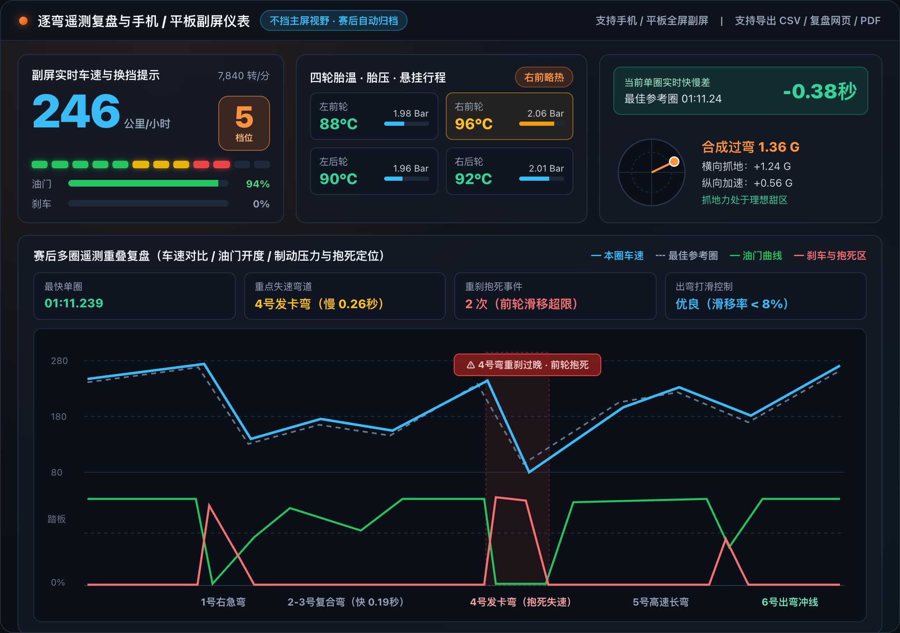
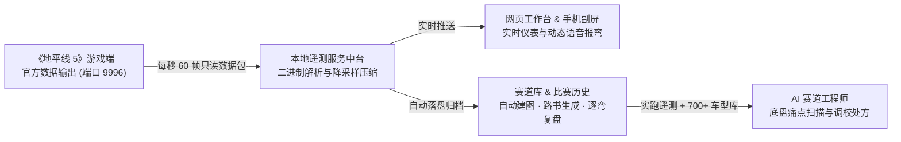

<div align="center">

# 《地平线 5》智能遥测平台 (`DM-FH5-Telemetry`)

**跑一圈自动录制赛道与生成拉力语音路书 —— 集自动建图、逐弯遥测复盘、实跑 AI 调车与副屏实时领航于一体**

<p>
  <a href="README.md"></a>
  <a href="README_EN.md"></a>
  
  <a href="UDP-DATA-FIELDS.md"></a>
  
  <a href="LICENSE"></a>
</p>

[核心亮点一览](#核心亮点一览) · [五大功能模块](#五大功能模块) · [3 步快速开跑](#3-步快速开跑) · [可选进阶配置](#可选进阶配置ai-调车与语音播报) · [非外挂安全声明](#非外挂安全声明与开源协议) · [更新日志](CHANGELOG.md)

</div>

---

## 核心亮点一览

在《极限竞速：地平线 5》里跑陌生自制图、刷山道冲刺赛或自己动手调车时，光靠游戏自带界面既记不住弯道、复盘没有抓手，按下 `T` 键还会把整块挡风玻璃糊满白字。

**`DM-FH5-Telemetry`** 通过监听游戏官方开放的遥测数据流，为你提供一套完整的本地赛车工程遥测平台：

### 1. 跑一圈自动录制赛道、自动生成动态语音路书

无需人工描点——开上赛道跑完一圈，系统自动区分**闭合环道**与**点对点冲刺赛段**，提取全赛道每个弯道的方向、曲率等级与参考车速，生成可微调的拉力路书；实战时按 **实时车速 × 3.5 秒动态提前量** 语音播报（连续复合弯自动合并成句），雨雾夜赛也能提前找准重刹点。

<p align="center">
  
</p>

### 2. 逐弯遥测复盘 + 实跑数据 AI 调车 + 手机副屏领航

<table>
<tr>
<td width="50%" valign="top">
  
  <br>
  <b>逐弯遥测复盘与副屏实时仪表</b>：自动归档每场练习与比赛，重叠对比本圈与最佳圈的车速、油门、刹车曲线并定位重刹抱死弯道；同时支持将手机、平板或电脑副屏变成独立全屏仪表盘，主屏幕保持 100% 纯净视野。
</td>
<td width="50%" valign="top">
  
  <br>
  <b>实跑遥测扫描与 AI 底盘调校</b>：内置 700+ 台官方车型参数、单车合法引擎置换池与部件四态锁止识别，结合实跑数千帧遥测与主观驾驶感受，针对入弯推头、重刹抱死、悬挂触底给出可一键应用的调校处方。
</td>
</tr>
</table>

---

## 五大功能模块

通过顶部导航栏（或键盘快捷键 `1` ~ `5`）在五大工作台之间一键切换：

| 模块（快捷键） | 主要用途 |
|---|---|
| **`1` · 实时仪表盘** | 60 帧/秒实时展示档位车速、换挡提示灯、拉力路书大字领航、四轮胎温胎压、悬挂压缩比、过弯 G 力与分段快慢差 |
| **`2` · 赛道管理** | 自动录制并缝合环道/冲刺赛轨迹，自动划分弯道等级与路书口令；支持手动微调弯心、多段轨迹合并及导出图片/路书文本 |
| **`3` · 比赛中心** | 自动压缩归档每场遥测记录；支持 2D 操控热力图、逐弯入弯/弯心/出弯车速诊断，以及导出 **CSV / 复盘网页 / PDF 报告** |
| **`4` · 车辆管理** | 上车自动识别当前驾驶车型；内置 **700+ 台官方车型基础规格**与单车专属合法候选引擎映射，防止跨车系错配 |
| **`5` · 调教工坊** | 胎压、四轮定位、防倾杆、弹簧阻尼、空力与差速器精细管理，自动识别锁止部件，支持多版本对比与 **AI 遥测问诊** |

---

## 3 步快速开跑

### 第 1 步：在游戏内开启官方数据输出

进入《地平线 5》 **设置 → HUD 与玩法 → 滚至最底部**：
- **数据输出**：`开启`
- **数据输出 IP 地址**：同一台电脑运行填 `127.0.0.1`；若遥测平台运行在局域网另一台电脑上，填写那台电脑的局域网 IP
- **数据输出端口**：`9996`

### 第 2 步：启动本地遥测平台（默认网页端口 `9188`）

- **macOS 双击一键启动（推荐）**：克隆仓库后直接双击根目录的 [`启动FH5遥测.command`](启动FH5遥测.command)，自动完成依赖检查、前端构建并打印访问地址。
- **Windows / macOS / Linux 命令行启动**（需安装 `Node.js >= 20`）：

```bash
git clone https://github.com/dylanma8232-art/DM-FH5-Telemetry.git
cd DM-FH5-Telemetry/forza-telemetry

npm run install:all
npm run build:client
npm start
```

### 第 3 步：打开网页工作台（或手机副屏）

- **本机或电脑副屏**：浏览器打开 `http://localhost:9188`
- **手机 / 平板副屏（同一 Wi-Fi）**：浏览器打开启动终端里提示的 `http://<电脑局域网IP>:9188`（在手机浏览器点「添加到主屏幕」即可全屏无边框使用）

---

## 可选进阶配置（AI 调车与语音播报）

基础遥测、自动录赛道、浏览器原生语音报路书与赛后复盘**开箱即用，无需配置任何密钥**。如需开启大模型 AI 调车问诊，可将 [`.env.example`](.env.example) 复制为 `.env`（或在页面右上角设置面板中直接填写）：

| 配置项 | 是否必填 | 说明 |
|---|---|---|
| `DASHSCOPE_API_KEY` | 可选 | 填入阿里云百炼（或任意兼容接口）密钥后，即可在「调教工坊」与「比赛中心」启用 AI 底盘问诊 |
| `DASHSCOPE_BASE_URL` | 可选 | 默认使用百炼兼容地址，也可切换为其他兼容大模型服务商地址 |
| `DASHSCOPE_MODEL` | 可选 | 默认使用 `qwen3.7-plus`，可按需更换推理模型 |
| 语音播报引擎 | 免配即用 | 默认启用浏览器本地低延迟语音播报，支持在设置面板调节语速、提前系数或接入云端语音 |

---

## 系统工作流与参考文档



- [`UDP-DATA-FIELDS.md`](UDP-DATA-FIELDS.md) — 《地平线 5》324 字节数据包字段偏移与物理量说明
- [`CODEMAP.md`](CODEMAP.md) — 前后端目录与模块结构索引
- [`CHANGELOG.md`](CHANGELOG.md) — 历次版本功能升级与性能优化记录

---

## 非外挂安全声明与开源协议

1. **100% 官方接口只读，零封号风险**：本平台仅单向接收《极限竞速：地平线 5》官方内置开放的遥测广播数据，**绝不读取、注入、挂钩或修改任何游戏进程内存与本地文件**，完全符合官方公平竞技规范。
2. **非商业开源协议**：基于 **[CC BY-NC-SA 4.0](LICENSE)** 协议开源，仅供玩家个人学习与交流，**严禁在任何电商、二手平台或付费社群打包售卖及商业牟利**。

---

## 关于作者

作者：**[dylanma8232-art](https://github.com/dylanma8232-art)** · **[返回个人主页查看更多开源项目 →](https://github.com/dylanma8232-art)**
