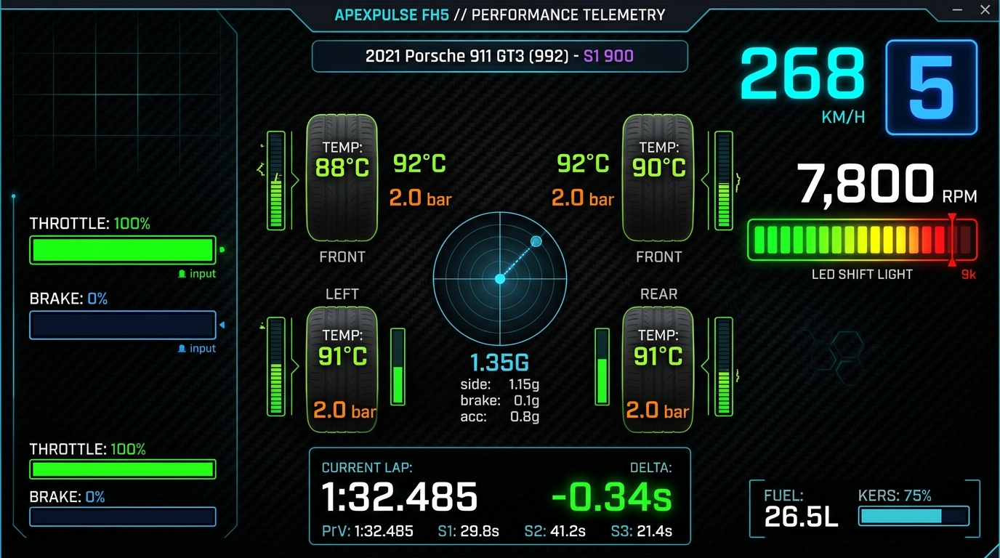
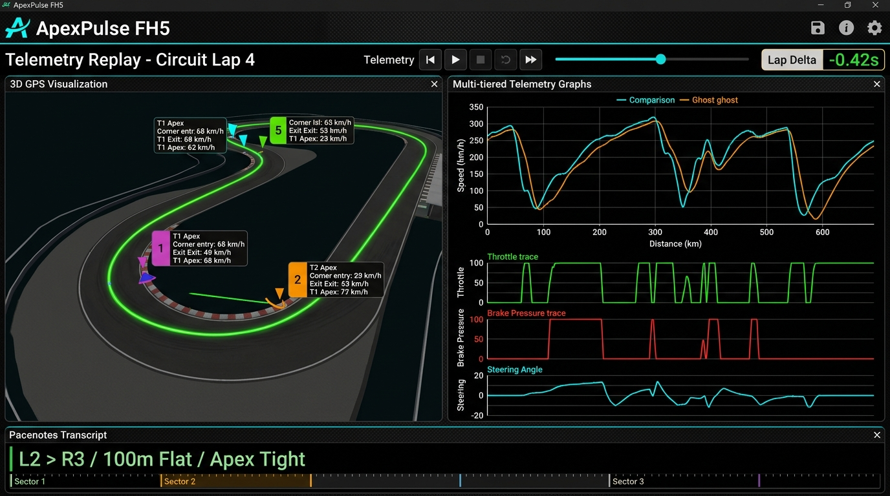

# DM- FH5遥测中台 🏎️💨

<p align="center">
  
</p>

<p align="center">
  <b>你的手机 / iPad / 副屏，秒变专业赛车仪表与 AI 赛道副驾。</b>
</p>

<p align="center">
  <a href="LICENSE"></a>
  
  
  
</p>

---

## 解决什么问题

玩《地平线 5》刷圈和调校时，大部分玩家都遇到过这三个别扭的痛点：

1. **想看遥测数据，游戏自带界面大面积挡视线。**  
   按 T 键开遥测，白花花的数据挡满挡风玻璃正中央，连出弯路线都看不清。  
   👉 **把副屏/手机立在方向盘前**：50+ 赛车组件独立高刷显示，四轮摩擦力极限圆（Friction Circle）、瞬时悬挂行程、胎温胎压热力分布一目了然。

2. **推头甩尾全靠猜，调校只能网上去抄作业。**  
   抄来的调校不适合自己跑法，过弯推头不知道改哪根防倾杆，换辆车又抓瞎。  
   👉 **大模型 AI 调校教练**：跑完 3 圈直接出诊断：“3 号弯入弯推头，建议前防倾杆下调 2 格、增加前轮下压力”。数据驱动，告别玄学改车。

3. **跑图不知道慢在哪，夜赛或大雾天频繁冲出赛道。**  
   陌生赛道记不住弯角急缓，盲目刷圈不知道哪一脚刹车踩早了。  
   👉 **自动提取弯心 + 拉力语音路书**：算法自动提取赛道中心线，语音提前预警“右急弯、接左全油直道”；赛后多圈速度重叠曲线毫秒级看清差距。

---

## 实机画面展示

### 1. 赛道地图与拉力级语音路书
自动提取三维轨迹、弯心 Apex 与出入弯速度，结合语音合成实时报弯。

<p align="center">
  
</p>

### 2. 调校工坊与 AI 赛车教练
收录 700+ 台车辆官方数据，由大模型（Qwen）直接生成车队工程师级的赛后诊断报告。

<p align="center">
  
</p>

---

## 3 步开跑

### 1. 游戏内开启数据输出
在《地平线 5》**设置 ➔ HUD 与玩法 ➔ 滚到最底部**：
* **数据输出 (Data Out)**：开启 (ON)
* **数据输出 IP**：填写电脑 IP（本机玩填 `127.0.0.1`）
* **数据输出端口**：`9996`

### 2. 启动服务
```bash
git clone https://github.com/dylanma8232-art/DM-FH5-Telemetry.git
cd DM-FH5-Telemetry/forza-telemetry

npm run install:all
npm run build:client
npm start
```

### 3. 打开仪表盘
* 电脑副屏打开：`http://localhost:9188`
* 手机 / iPad 打开：`http://你的电脑局域网IP:9188`

*(可选：根目录复制 `.env.example` 为 `.env` 并填入阿里云百炼 Key，即可激活 AI 赛车教练)*

---

## 许可证与非外挂声明

* **开源协议**：本项目基于 **[CC BY-NC-SA 4.0](LICENSE)** 协议开源。仅供个人交流学习，**严禁任何电商/二手平台打包倒卖**。
* **安全合规**：仅只读监听游戏原生开放的 UDP 广播（324 字节），绝不读取或篡改游戏内存与文件，非外挂作弊软件。
