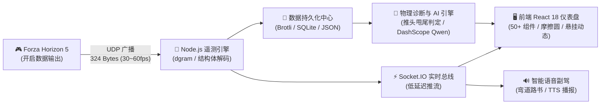

# ApexPulse FH5 🏎️💨
### 《极限竞速：地平线 5》专业遥测分析与 AI 赛道副驾系统
**Full-stack Telemetry Analytics, Professional Multi-display HUD & AI Race Engineer for Forza Horizon 5**

---

[](https://creativecommons.org/licenses/by-nc-sa/4.0/)
[](https://forza.net/)
[-green?style=for-the-badge)](UDP-DATA-FIELDS.md)
[](https://react.dev/)
[](https://nodejs.org/)
[](https://socket.io/)
[](https://help.aliyun.com/document_detail/2712195.html)

---

> [!CAUTION]
> ### 🛑 严正声明与反盗卖红线
> 1. **严禁商用**：本项目基于 **CC BY-NC-SA 4.0** 协议开源，完全免费。**严禁任何组织或个人在淘宝、闲鱼、拼多多、微信群或任何第三方商业平台进行付费打包销售、代搭建或二次包装牟利**。如果你是花钱购买的，请立即申请退款并举报商家！
> 2. **非外挂/免责声明**：本项目为**独立第三方数据可视化与驾驶辅助工具**，与微软（Microsoft Corporation）、Playground Games、Turn 10 Studios 官方无任何商业关联。本系统**仅监听游戏原生开放的 UDP 广播端口（只读）**，绝不读取、注入或篡改游戏内存，不修改任何游戏文件，绝非作弊软件。

---

## 📖 项目简介

在《极限竞速：地平线 5》中，自带的遥测页面存在诸多痛点：不仅大面积遮挡驾驶视线，而且无法自动记录整圈数据，更缺乏对底盘动态、轮胎抓地力和进出弯走线的深度分析。

**ApexPulse FH5** 是一套专为模拟器玩家、圈速党与调校玩家打造的**全功能比赛数据中心与智能副驾系统**：
* 📱 **副屏/平板秒变专业赛车仪表**：通过手机、iPad 或副屏浏览器打开，即可实时呈现 50+ 项专业赛车遥测动态（转速、悬挂压缩、四轮载荷、轮胎抓地力圆）。
* 🗺️ **自动赛道提取与弯道路书**：无需人工录制，系统利用聚类与中心线平滑算法，实时识别圈道、自动提取赛道弯心，并调用 **小米 TTS / Web Speech** 进行拉力级语音路书播报（例如：“左急弯、接右全油通过”）。
* 📊 **比赛中心与圈速对比**：Brotli 压缩高效存储数万点遥测轨迹，分段计时、走线对比、刹车点分析一目了然。
* 🤖 **AI 调校大师与驾驶工程师**：内置力学诊断引擎，实时发现推头（Understeer）、甩尾（Oversteer）与避震托底；更可接入 **阿里云百炼（DashScope Qwen）大模型**，为你提供赛车工程师级别的个性化调校与驾驶复盘报告。

---

## 🏗️ 系统架构



---

## ⚡ 功能特性矩阵 (Feature Matrix)

### ✅ 已完整实现 (Fully Implemented)

| 模块 | 功能项 | 详细说明 |
|---|---|---|
| **实时遥测 (Telemetry)** | 324 字节高频解析 | 支持 FH5 标准/Dash 格式（车速、转速、挡位、四轮物理载荷、轮胎温度、滑动角） |
| | 极低延迟推送 | 基于 Socket.IO 实时同步到前端，支持多终端同时接入 |
| **专业仪表盘 (HUD)** | 赛车动态仪表 | 速度计、RPM 光带、挡位、油门/刹车/离合线性开度 |
| | 轮胎与悬挂监控 | 四轮瞬时受力、悬挂行程压缩率、轮胎胎温胎压热力分布 |
| | 摩擦力极限圆 | 实时 G 力图与四轮抓地力极限边界绘制 |
| **赛道与路书 (Track)** | 赛道智能构建 | 自动轨迹清洗、RDP 抽稀、三次样条中心线提取、闭环环道自动识别 |
| | 弯道与路书生成 | 自动识别弯道曲率、入弯点、弯心（Apex）与出弯点 |
| | 语音路书导航 | 弯道提前预警语音提示（支持小米 TTS 与系统 Web Speech） |
| **比赛中心 (Session)** | 圈速与分段记录 | 自动检测起终点计时、扇区划分、最佳圈速排行 |
| | 遥测曲线回放 | 圈速对比覆盖图、速度/刹车重叠分析曲线、高效 Brotli 数据压缩存储 |
| **车辆与调校 (Workshop)** | 官方车辆数据库 | 收录全系 700+ 台车辆官方基础参数、驱动形式与 PI 等级 |
| | 专业调校工坊 | 胎压、变速箱齿比、四轮定位、防倾杆、避震阻尼、气动下压力参数管理 |
| | 规则级调校诊断 | 根据实测遥测数据自动检测并给出悬挂软硬、胎压过载、车身托底诊断 |
| | 大模型 AI 驾驶教练 | 接入 DashScope API，生成结构化赛后驾驶复盘与进阶调校指导 |

### 🚧 规划中路线图 (Roadmap)

- [ ] **v1.2.0**: 手机端专属竖屏极简 HUD 模式（支持添加到主屏幕 PWA）
- [ ] **v1.3.0**: 局域网多人幽灵对决（Multiplayer LAN Ghost Delta 对比）
- [ ] **v1.4.0**: 专业级 MoTeC i2 Pro 数据格式导出（`.ld` / `.ldx`）
- [ ] **v1.5.0**: 外部实体硬件仪表盘桥接（SimHub 协议 / Arduino LED / Nextion 串口屏）

---

## 🚀 极速上手

### 步骤 1：游戏内配置遥测数据输出
在《极限竞速：地平线 5》游戏内，依次打开：
**「设置」 ➔ 「HUD 与玩法 (HUD & Gameplay)」 ➔ 滚到最底部**：
1. **数据输出 (Data Out)**：设置为 **开启 (ON)**
2. **数据输出 IP 地址 (Data Out IP Address)**：填写**运行本项目电脑的局域网 IP**（如 `127.0.0.1` 或同一 Wi-Fi 下电脑的局域网 IP 如 `192.168.1.100`）
3. **数据输出 IP 端口 (Data Out IP Port)**：填写 **`9996`**

---

### 步骤 2：启动本项目

#### 环境要求
* [Node.js](https://nodejs.org/) (推荐 v18.0.0 或更高版本)
* npm 8+

#### 运行命令
```bash
# 1. 克隆本仓库
git clone https://github.com/dylanma8232-art/FH5-.git
cd FH5-/forza-telemetry

# 2. 安装全部依赖
npm run install:all

# 3. 编译前端
npm run build:client

# 4. 启动服务（后端 + 静态托管 + UDP 接收器）
npm start
```

*打开浏览器访问：**`http://localhost:9188`**（如果使用手机/平板访问，访问 `http://你的电脑局域网IP:9188` 即可）。*

*(可选) 配置 AI 大模型分析：复制根目录的 `.env.example` 为 `.env`，填入你的阿里云百炼 API Key 即可激活大模型赛车教练功能。*

---

## 🏷️ 仓库标签 (Topics)

`forza-horizon-5` · `sim-racing` · `telemetry` · `dashboard` · `hud` · `ai-coach` · `dashscope` · `qwen` · `react` · `nodejs` · `socket-io` · `motorsport`

---

## 📜 版本更新历史 (Release Notes)

- **v1.1.5 (2026-10)**
  - ✨ 全面接入开源合规体系，采用 `CC BY-NC-SA 4.0` 严禁商用协议。
  - 🧹 全面移除个人测试存档与冗余调试脚本，代码库深度治理与瘦身。
  - 🤖 优化 DashScope 兼容接口，提升 AI 驾驶教练诊断稳定性。
  - 🔄 接入 GitHub Actions 全自动 CI 修复与 PR 自动归档工作流。
- **v1.1.0 (2026-08)**
  - 🏁 新增赛道智能中心线提取算法（RDP 抽稀与闭环检测）。
  - 🔊 集成拉力语音副驾与小米 TTS / Web Speech 弯道路书播报。
  - 🔧 升级全车系调校工坊与规则级物理诊断。
- **v1.0.0 (2026-06)**
  - 🚀 初始版本发布，支持 FH5 324B UDP 遥测解析与 React 基础仪表盘。

---

## ⚖️ 开源许可证

本项目采用 **[Creative Commons Attribution-NonCommercial-ShareAlike 4.0 International Public License (CC BY-NC-SA 4.0)](LICENSE)** 许可证。

* **你可以**：免费运行、学习、分享以及对本项目进行修改。
* **你必须**：保留原作者署名，且修改后的衍生项目必须以相同协议开源。
* **你严禁**：**将本项目或任何衍生版本用于任何商业牟利、付费收费、付费群打包或转卖行为。**
