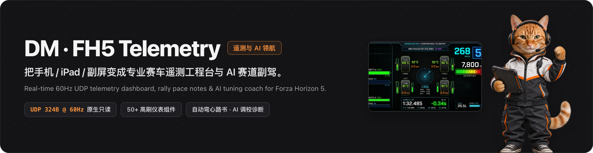
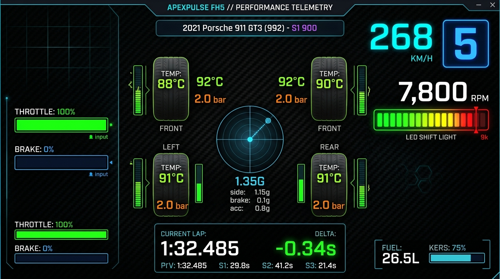
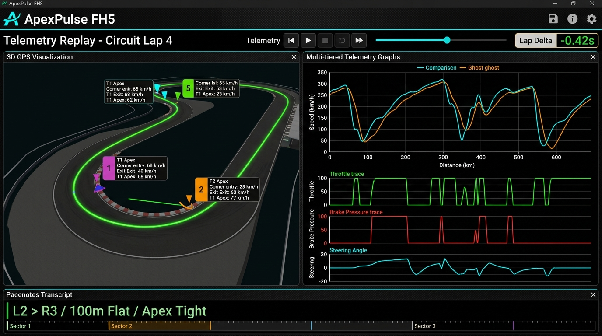
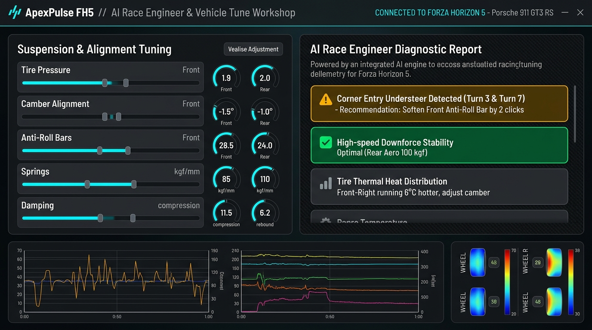

<picture>
  <source media="(prefers-color-scheme: dark)" srcset="assets/banner-dark.png">
  <source media="(prefers-color-scheme: light)" srcset="assets/banner-light.png">
  
</picture>

<div align="center">

<p>
  <a href="README.md"></a>
  <a href="README_EN.md"></a>
  
  
  
  <a href="LICENSE"></a>
</p>

[3 步极速开跑](#3-步极速开跑) · [实机画面展示](#实机画面展示) · [解决的三大痛点](#解决什么问题) · [非外挂安全声明](#许可证与非外挂声明) · [English](README_EN.md)

</div>

---

## 解决什么问题

在《极限竞速：地平线 5》（Forza Horizon 5）里刷圈和调校时，玩家最常卡在三个痛点上：

- **原生遥测严重遮挡视野**：按下 `T` 键打开游戏内置遥测，密密麻麻的白字直接糊满挡风玻璃正中央，连入弯弯心都看不清。
  - **解法**：通过局域网把手机、iPad 或电脑副屏独立成 **50+ 组件高刷工程仪表台**——四轮摩擦力极限圆（Friction Circle）、瞬时悬挂行程、胎温胎压热力分布一眼掌控，主屏幕保持 100% 纯净视野。
- **推头甩尾全凭玄学抄作业**：网上抄的调校码不适合自己的走线习惯，过弯推头不知道该动防倾杆还是阻尼，换台车又得从头试错。
  - **解法**：内置 **700+ 台官方车型参数库 + 大模型 AI 调校工程师**。跑完 3 圈直接基于遥测数据给出诊断建议（例如：「3 号弯入弯推头明显，建议前防倾杆下调 2 格并微增前下压力」）。
- **陌生赛道记不住弯、慢在哪说不清**：夜赛或雨雾天频繁错过刹车点，盲目刷圈却不知道自己比上一圈慢在哪个出弯。
  - **解法**：算法自动提取三维赛道中心线与弯心（Apex），生成**实时拉力语音路书**提前报弯；赛后支持多圈速度重叠曲线毫秒级对比复盘。

---

## 3 步极速开跑

### 1. 在游戏内开启原生 UDP 数据输出

进入《地平线 5》**设置 → HUD 与玩法 → 滚至最底部**：
- **数据输出（Data Out）**：开启（`ON`）
- **数据输出 IP**：本机副屏填写 `127.0.0.1`（跨设备观看填游戏电脑的局域网 IP）
- **数据输出端口**：`9996`

### 2. 安装并启动遥测中台

```bash
git clone https://github.com/dylanma8232-art/DM-FH5-Telemetry.git
cd DM-FH5-Telemetry/forza-telemetry

npm run install:all
npm run build:client
npm start
```

### 3. 在副屏或移动设备打开仪表盘

- **电脑副屏**：浏览器访问 `http://localhost:9188`
- **手机 / iPad（同一 Wi-Fi）**：浏览器访问 `http://<你的电脑局域网IP>:9188`

> 可选开启 AI 赛车教练：将根目录 `.env.example` 复制为 `.env` 并填入阿里云百炼（DashScope）API Key，即可解锁赛后 AI 调校与走线诊断。

---

## 实机画面展示

<p align="center">
  
  <br>
  <sub><b>主副屏遥测仪表台</b>：实时转速/档位、G 值摩擦圆、四轮胎温胎压与油门刹车曲线</sub>
</p>

<table>
<tr>
<td width="50%" valign="top">
  
  <br>
  <sub><b>赛道识别与拉力语音路书</b>：自动提取三维轨迹、弯心 Apex 与出入弯速度，实时语音报弯预警</sub>
</td>
<td width="50%" valign="top">
  
  <br>
  <sub><b>调校工坊与 AI 赛道工程师</b>：结合 700+ 台车辆基础数据与实跑遥测，输出针对性底盘调校处方</sub>
</td>
</tr>
</table>

---

## 许可证与非外挂声明

- **100% 原生安全合规**：本系统仅只读监听《极限竞速：地平线 5》官方原生开放的 UDP 遥测广播包（324 字节），**绝不读取、注入或修改任何游戏进程内存与本地文件**，不属于外挂或作弊软件，无封号风险。
- **开源协议**：基于 **[CC BY-NC-SA 4.0](LICENSE)** 协议开源，仅供玩家个人学习与交流，**严禁任何电商或二手平台打包售卖**。

---

## 关于作者

作者：**[Dylan.ma](https://github.com/dylanma8232-art)** · [查看主页更多开源工具与实验项目 →](https://github.com/dylanma8232-art?tab=repositories)
