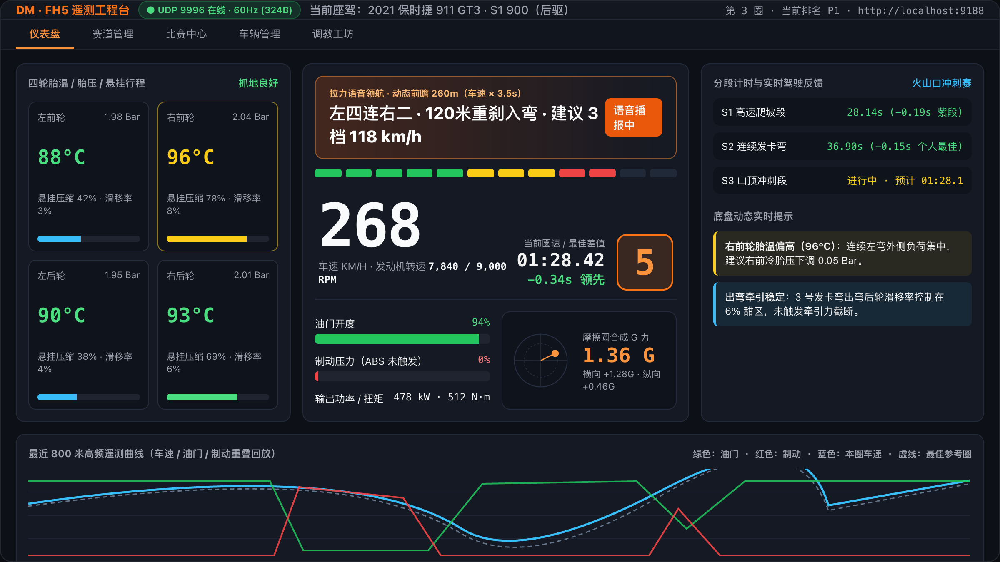
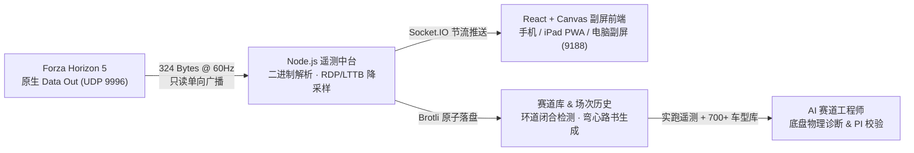

<div align="center">

# 《地平线 5》手机副屏仪表台 (`DM-FH5-Telemetry`)

**把手机或平板变成实时赛车仪表盘 —— 不挡游戏主屏幕，还能自动语音报弯道、让 AI 帮你调车**

<p>
  <a href="README.md"></a>
  <a href="README_EN.md"></a>
  
  <a href="UDP-DATA-FIELDS.md"></a>
  
  
  <a href="LICENSE"></a>
</p>

[解决什么问题](#解决什么问题) · [五大核心工作台](#五大核心工作台) · [3 步极速开跑](#3-步极速开跑) · [数据流与协议文档](#系统数据流与协议文档) · [非外挂安全声明](#非外挂安全声明与开源协议) · [更新日志](CHANGELOG.md)

</div>

---

## 解决什么问题

在《极限竞速：地平线 5》（Forza Horizon 5）里认真刷圈、跑拉力赛段或自己动手调车时，玩家最常卡在三个痛点上：

- **原生遥测大面积遮挡挡风玻璃**：按下 `T` 键开启游戏自带遥测面板，密密麻麻的白字直接糊在视野正中央，高速入弯连弯心都看不清。
  - **解法**：通过局域网将手机、iPad 或电脑副屏独立为 **PWA 全屏高刷遥测工程台**——转速换挡灯、G 值摩擦圆、四轮胎温胎压与悬挂行程一目了然，主屏幕保持 100% 纯净驾驶视野。
- **陌生赛道记不住弯、雨夜总错过刹车点**：冲刺赛或夜雾天频繁冲出弯外，跑完一圈也不知道自己比最佳圈慢在哪个出弯。
  - **解法**：算法自动识别环道闭合点与曲率弯心（Apex），按 **实时车速 × 3.5 秒动态前瞻距离** 提前播报拉力语音路书（复合连续弯自动合并成句）；赛后支持多圈遥测曲线重叠复盘。
- **推头甩尾全凭玄学抄调校码**：网上抄的分享码不适合自己的走线习惯，入弯推头不知道该软化前防倾杆还是调制动分配，跨车系还容易搞混可调部件边界。
  - **解法**：内置 **700+ 台官方车型参数库、单车专属引擎置换池与四态部件锁止矩阵**，配合大模型 **AI 赛道物理诊断师**，结合实跑遥测与你的主观驾驶体感直接给出可落地的底盘调校处方。

---

## 五大核心工作台

系统通过顶部标签页（或快捷键 `1` ~ `5`）在五大专业工作台之间无缝切换：

<p align="center">
  
</p>

| 工作台（快捷键） | 核心功能亮点 |
|---|---|
| **`1` · 仪表盘** | 实时解析 324B UDP 数据包；支持四轮胎温热力、悬挂触底监测、摩擦圆 G 值、分段紫段计时与驾驶异常实时提示 |
| **`2` · 赛道管理** | 自动区分环道与点对点冲刺赛（闭合点 + 曲率周期双算法）；支持弯心微调、多段轨迹合并与车速自适应提前量语音路书 |
| **`3` · 比赛中心** | 自动归档每场练习与比赛（Brotli 高比压缩存储）；支持多圈速度曲线对比、排行榜联动，以及 **CSV / 增强 CSV / HTML 报告 / PDF** 导出 |
| **`4` · 车辆管理** | 上车即自动检测车型序号并弹窗提示；内置 **700+ 台官方车型基础规格**与单车专属 2~5 款合法候选引擎映射 |
| **`5` · 调教工坊** | 解耦胎压与四轮定位，防倾杆/空力套件四态锁止（前后可调/仅前/仅后/需升级），支持方案跨版比对与 **AI 遥测问诊一键应用** |

---

## 3 步极速开跑

### 第 1 步：在《地平线 5》内开启原生数据输出

进入游戏 **设置 → HUD 与玩法 → 滚至底部**：
- **数据输出（Data Out）**：`开启`
- **数据输出 IP 地址**：本机副屏填 `127.0.0.1`；若游戏 PC 与遥测主机分属局域网两台设备，填写运行本服务那台电脑的局域网 IP
- **数据输出端口**：`9996`

### 第 2 步：启动遥测中台服务（默认端口 `9188`）

**macOS 一键启动（推荐）**：克隆仓库后直接双击根目录的 [`启动FH5遥测.command`](启动FH5遥测.command)，脚本会自动检查 Node.js、安装前后端依赖、构建前端页面并打印本机局域网访问地址。

**跨平台命令行启动（Windows / macOS / Linux，需 `Node.js >= 20`）**：

```bash
git clone https://github.com/dylanma8232-art/DM-FH5-Telemetry.git
cd DM-FH5-Telemetry/forza-telemetry

npm run install:all
npm run build:client
npm start
```

### 第 3 步：在副屏或移动设备上打开仪表台

- **电脑副屏**：浏览器访问 `http://localhost:9188`
- **手机 / iPad（同一 Wi-Fi）**：浏览器访问 `http://<电脑局域网IP>:9188`
  - *小技巧*：在 iOS Safari 或 Android Chrome 中点击 **「添加到主屏幕」**，即可作为 **PWA 独立全屏应用**运行，彻底隐藏浏览器地址栏。

---

## 可选进阶配置（AI 诊断与高质量语音）

在仓库根目录将 [`.env.example`](.env.example) 复制为 `.env`（或在页面右上角设置面板 `Ctrl+E` 中在线填写）：

| 配置项 | 是否必填 | 作用说明 |
|---|---|---|
| `DASHSCOPE_API_KEY` | 可选 | 填入阿里云百炼 API Key 后，即可在「调教工坊」与「比赛中心」解锁大模型 AI 赛道物理问诊与改装求解 |
| `DASHSCOPE_BASE_URL` | 可选 | 默认 `https://dashscope.aliyuncs.com/compatible-mode/v1`（支持任意 OpenAI 兼容接口） |
| `DASHSCOPE_MODEL` | 可选 | 默认 `qwen3.7-plus`，可按需切换推理模型 |
| 语音播报引擎 | 免配即用 | 默认支持浏览器原生 Web Speech 低延迟播报，也可在设置面板配置小米 Mimo TTS 接口 |

---

## 系统数据流与协议文档



- [`UDP-DATA-FIELDS.md`](UDP-DATA-FIELDS.md) — 《地平线 5》324 字节 UDP 数据包（Sled 232B + Dash 79B + 扩展字节）完整偏移量与物理量对照表
- [`CODEMAP.md`](CODEMAP.md) — 前后端完整模块树与导出符号索引
- [`CHANGELOG.md`](CHANGELOG.md) — v2.0 / v2.1 性能优化战果与功能演进记录

---

## 非外挂安全声明与开源协议

1. **100% 原生只读，零封号风险**：本系统仅单向监听《极限竞速：地平线 5》官方内置开放的 UDP 遥测广播端口，**绝不读取、注入、挂钩或修改任何游戏进程内存与本地文件**，完全符合官方公平竞技规范。
2. **非商业开源协议**：基于 **[CC BY-NC-SA 4.0](LICENSE)** 协议开源，仅供模拟赛车与地平线玩家个人学习交流，**严禁在任何电商、闲鱼或社群平台打包售卖及商业牟利**。

---

## 关于作者

作者：**[Dylan.ma](https://github.com/dylanma8232-art)** · **[返回个人主页查看更多开源项目 →](https://github.com/dylanma8232-art)**
