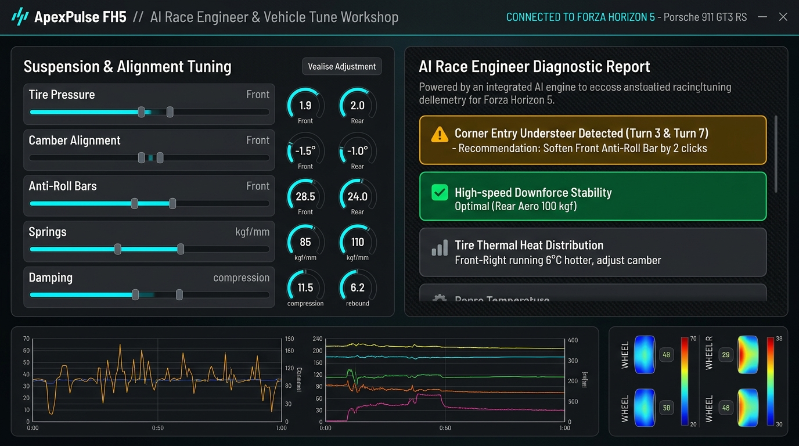
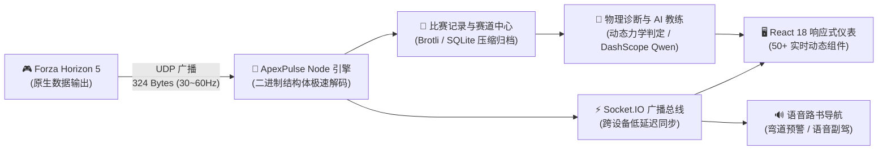

# ApexPulse FH5 🏎️💨
### 《极限竞速：地平线 5》全能遥测数据中心与 AI 赛道副驾系统
**Full-stack Telemetry Analytics, Multi-Display Racing HUD & AI Race Engineer for Forza Horizon 5**

---

[](LICENSE)
[](https://forza.net/)
[-green?style=for-the-badge)](UDP-DATA-FIELDS.md)
[](https://react.dev/)
[](https://nodejs.org/)
[](https://socket.io/)
[](https://help.aliyun.com/document_detail/2712195.html)

---

> [!CAUTION]
> ### 🛑 严正版权声明与反盗卖红线
> 1. **全网免费开源，严禁商用**：本项目采用 **CC BY-NC-SA 4.0** 国际许可证。**严禁任何个人、机构或电商店铺在淘宝、闲鱼、微信群等渠道进行任何形式的收费打包销售、付费群倒卖或商业牟利**。如果你是付费购买的，请立即退款并向平台举报不良商家！
> 2. **独立非官方合规声明**：本项目为**开源数据可视化与赛道辅助工具**，与微软（Microsoft Corporation）、Playground Games 及 Turn 10 Studios 无任何商业从属关系。系统**仅只读监听游戏原生合法的 UDP 遥测广播（324 字节）**，绝不读取、不注入、不修改游戏内存或游戏文件，绝非作弊软件。

---

## 📸 核心界面一览 (Visual Showcase)

### 1. 赛车动态仪表盘 (Live Telemetry Dashboard)
> 📱 **副屏/平板秒变 GT 赛车仪表**：实时呈现 50+ 项专业遥测数据，包括 RPM LED 换挡指示灯、四轮瞬时载荷、悬挂压缩率、摩擦力极限圆（Friction Circle）与轮胎热力分布。


---

### 2. 赛道地图与智能语音领航 (Track Map & Pacenotes Replay)
> 🗺️ **无需人工画线，自动构建赛道**：系统自动清洗 GPS 轨迹，提取三次样条中心线，自动检测弯道弯心（Apex）、入弯/出弯速度与刹车点，并支持拉力级语音路书实时播报。


---

### 3. 调校工坊与大模型 AI 赛车工程师 (AI Race Engineer & Workshop)
> 🤖 **告别盲目调校，让数据说话**：内置物理力学诊断引擎，自动检测推头（Understeer）、甩尾（Oversteer）与避震打底；支持接入大语言模型（Qwen/DashScope），生成专业车队工程师级的赛后复盘与调校修改方案。



---

## 🌟 为什么你需要 ApexPulse FH5？

地平线 5 自带的遥测界面不仅大面积遮挡视野，而且无法记录圈速历史、无法对比多圈走线，更无法告知你的调校究竟是“偏硬”还是“阻尼不足”。

* **专业模拟器级别体验**：手机、iPad、甚至旧笔记本连上同一 Wi-Fi，打开网页就是一套媲美 MoTeC 赛车数据系统的副屏仪表。
* **拉力车手专属智能副驾**：实时赛道识别结合语音合成，在未知赛道上提前为你预警：“右4急弯、接左全油直道”。
* **圈速重叠复盘 (Delta Telemetry)**：毫秒级多圈速度曲线重叠对比，清楚看清自己在哪一个弯道丢掉了 0.3 秒。
* **调校诊断闭环**：全系 700+ 台车辆官方参数库，结合你的实测跑圈数据，一键生成阻尼、防倾杆、差速器的微调建议。

---

## 🏗️ 极速数据流架构



---

## ⚡ 功能特性矩阵 (Feature Matrix)

| 核心模块 | 已实现能力 (Implemented) | 规划中路线 (Roadmap) |
|---|---|---|
| **实时遥测** | 324 字节高频 UDP 解析、车速/转速/挡位/四轮物理受力/轮胎滑动角/悬挂行程 | 外部硬件仪表盘联动（SimHub 协议 / Arduino LED / Nextion 串口屏） |
| **赛道与路书** | 自动轨迹清洗、RDP 抽稀、闭环赛道检测、弯心 Apex 识别、拉力语音路书 | 社区共享赛道路书库 |
| **比赛中心** | 自动计时、扇区划分、多圈速度/刹车/油门重叠曲线回放、Brotli 压缩存储 | 局域网多人幽灵对决（Multiplayer Ghost Delta 实时差值对比） |
| **调校与 AI** | 700+ 台官方车辆库、专业调校参数管理、推头/甩尾/托底规则级自动诊断、大模型驾驶教练报告 | 专业赛车级 MoTeC i2 Pro 数据格式导出（`.ld` / `.ldx`） |

---

## 🚀 极速上手 (3 步开启)

### 步骤 1：游戏内配置遥测数据输出
在《极限竞速：地平线 5》游戏内，依次打开：
**「设置」 ➔ 「HUD 与玩法 (HUD & Gameplay)」 ➔ 滚到最底部**：
1. **数据输出 (Data Out)**：设置为 **开启 (ON)**
2. **数据输出 IP 地址 (Data Out IP Address)**：填写**运行本项目电脑的局域网 IP**（如 `127.0.0.1` 或同一 Wi-Fi 下电脑的局域网 IP 如 `192.168.1.100`）
3. **数据输出 IP 端口 (Data Out IP Port)**：填写 **`9996`**

---

### 步骤 2：启动本项目服务
```bash
# 1. 克隆本仓库
git clone https://github.com/dylanma8232-art/ApexPulse-FH5.git
cd ApexPulse-FH5/forza-telemetry

# 2. 安装依赖并编译前端
npm run install:all
npm run build:client

# 3. 启动服务
npm start
```

---

### 步骤 3：副屏或移动端访问
* **本机浏览器**：打开 **`http://localhost:9188`**
* **手机/iPad/副屏**：打开 **`http://你的电脑局域网IP:9188`**
* *(可选 AI 功能)*：将根目录 `.env.example` 复制为 `.env`，填入阿里云百炼 DashScope API Key 即可激活大模型赛车教练。

---

## ⚖️ 开源许可证

本项目采用 **[Creative Commons Attribution-NonCommercial-ShareAlike 4.0 International (CC BY-NC-SA 4.0)](LICENSE)** 许可证。

* ✅ **允许**：个人免费使用、修改、技术研究与非商业分享。
* ❌ **严禁**：任何形式的商业牟利、付费收费、付费群打包或转卖行为。
