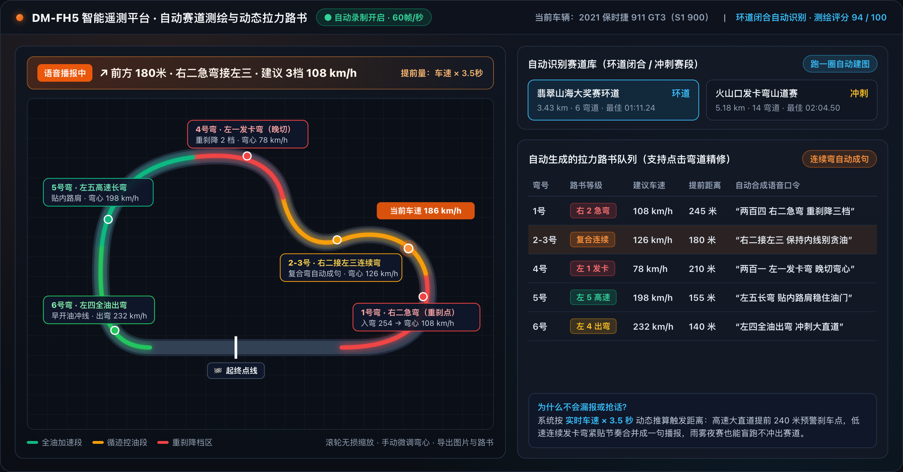
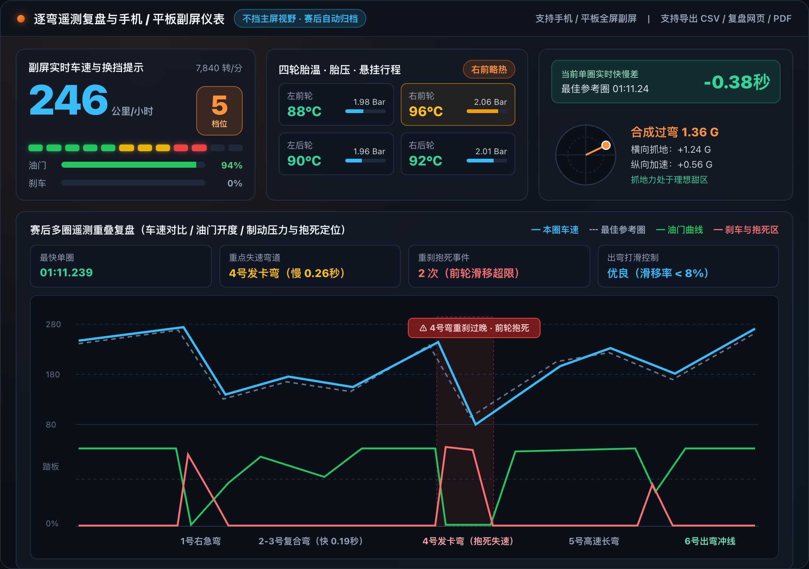
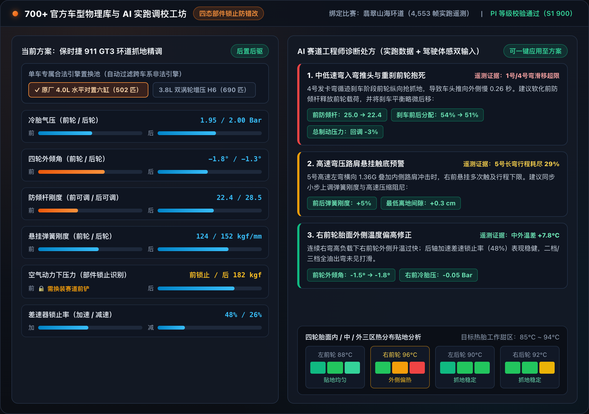
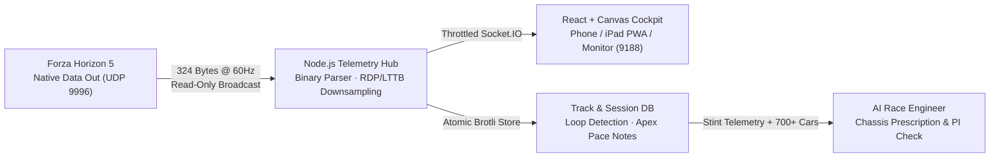

<div align="center">

# DM-FH5-Telemetry

**Smart telemetry platform for Forza Horizon 5 — auto track mapping, speed-adaptive rally pace notes, corner-by-corner replay, AI setup tuning & second-screen HUD**

<p>
  <a href="README.md"></a>
  <a href="README_EN.md"></a>
  
  <a href="UDP-DATA-FIELDS.md"></a>
  
  
  <a href="LICENSE"></a>
</p>

[Why DM-FH5-Telemetry](#why-dm-fh5-telemetry) · [Five Core Workspaces](#five-core-workspaces) · [3-Step Quickstart](#3-step-quickstart) · [Architecture & Protocol](#architecture--udp-protocol) · [Fair-Play Statement](#fair-play-statement--license) · [Changelog](CHANGELOG.md)

</div>

---

## Why DM-FH5-Telemetry

Chasing lap times, running night rally stages, or dialing in suspension setups in **Forza Horizon 5** typically hits three bottlenecks:

- **Built-in telemetry blocks the windshield**: Pressing `T` plasters raw white debug text right across your braking zones and apexes.
  - **Solution**: Offload a **full-screen PWA 60Hz telemetry cockpit** onto any phone, iPad, or secondary monitor over Wi-Fi — shift LEDs, G-force friction circle, 4-corner tire heatmaps, and suspension travel stay crystal clear while your main display remains 100% clean.
- **Missed braking points on unfamiliar routes**: Blind crests, rain, or night stages lead to late braking, with no easy way to see where 0.3s slipped away.
  - **Solution**: Automatic loop-closure detection and curvature apex extraction generate **speed-adaptive spoken rally pace notes** (`current_speed × 3.5s` dynamic lookahead with compound corner phrasing), paired with multi-lap speed trace overlays after your run.
- **Guesswork when tuning out understeer or snap oversteer**: Generic shared tune codes hide their parameters and rarely match your driving style.
  - **Solution**: Combines an **official 700+ vehicle spec database, per-car legal engine swap pools, and 4-state adjustable part lock matrices** with an **LLM AI Race Engineer** that translates real stint telemetry + driver feel into concrete setup adjustments.

---

## Five Core Workspaces

Switch instantaneously across five specialized workspaces via top tabs or hotkeys `1`–`5` (UI labels follow a clean Chinese motorsport layout):

<p align="center">
  
</p>

<table>
<tr>
<td width="50%" valign="top">
  
</td>
<td width="50%" valign="top">
  
</td>
</tr>
</table>

| Workspace (Hotkey) | Key Capabilities |
|---|---|
| **`1` · Live Cockpit** | Parses 324-byte UDP packets in real time; 4-wheel thermal/slip monitoring, bottoming-out alerts, purple sector splits, and live chassis feedback |
| **`2` · Track Manager** | Auto-detects closed circuits vs. point-to-point sprints; supports manual apex editing, track merging, and `speed × 3.5s` lookahead voice callouts |
| **`3` · Session Center** | Brotli-compressed session recording, multi-lap speed/pedal replay, track leaderboards, and **CSV / Enhanced CSV / HTML / PDF** report exports |
| **`4` · Vehicle Garage** | Auto-detects the active car ordinal on track; ships with **700+ official FH5 vehicle baselines** and per-car legal engine swap mappings |
| **`5` · Tuning Workshop** | Decouples tire pressure from alignment, models 4-state ARB/aero locks, diffs setup versions, and applies **AI physics diagnostics** in one click |

---

## 3-Step Quickstart

### Step 1: Enable Native UDP Data Out in Forza Horizon 5

In Forza Horizon 5, open **Settings → HUD and Gameplay → scroll to the bottom**:
- **Data Out**: `ON`
- **Data Out IP Address**: `127.0.0.1` (if running the hub on the same PC) or the LAN IP of the machine running this server
- **Data Out IP Port**: `9996`

### Step 2: Launch the Telemetry Hub (Port `9188`)

- **macOS 1-Click Launcher**: Double-click [`启动FH5遥测.command`](启动FH5遥测.command) in the repository root — it automatically verifies Node.js, installs missing packages, builds the client, and prints your LAN URL.
- **Cross-Platform CLI (Windows / macOS / Linux, `Node.js >= 20`)**:

```bash
git clone https://github.com/dylanma8232-art/DM-FH5-Telemetry.git
cd DM-FH5-Telemetry/forza-telemetry

npm run install:all
npm run build:client
npm start
```

### Step 3: Open Your Second-Screen Cockpit

- **PC second monitor**: Visit `http://localhost:9188`
- **Phone / iPad (same Wi-Fi)**: Visit `http://<YOUR_COMPUTER_LAN_IP>:9188`
  - *Tip*: Tap **"Add to Home Screen"** in iOS Safari or Android Chrome to launch it as a borderless full-screen **PWA cockpit**.

---

## Optional AI Coach & Voice Configuration

Copy [`.env.example`](.env.example) to `.env` in the repo root (or configure directly inside the in-app Settings modal via `Ctrl+E`):

| Variable | Required | Description |
|---|---|---|
| `DASHSCOPE_API_KEY` | Optional | Unlocks post-stint AI setup diagnostics and upgrade solving via DashScope / OpenAI-compatible LLMs |
| `DASHSCOPE_BASE_URL` | Optional | Defaults to `https://dashscope.aliyuncs.com/compatible-mode/v1` |
| `DASHSCOPE_MODEL` | Optional | Defaults to `qwen3.7-plus` |
| Voice Callout Engine | Built-in | Works out of the box via Web Speech API, with optional Xiaomi Mimo TTS cloud voice support |

---

## Architecture & UDP Protocol



- [`UDP-DATA-FIELDS.md`](UDP-DATA-FIELDS.md) — Complete byte-offset specification for FH5's 324-byte UDP packet (Sled + Dash)
- [`CODEMAP.md`](CODEMAP.md) — Module tree and exported symbol map
- [`CHANGELOG.md`](CHANGELOG.md) — v2.0 / v2.1 performance benchmarks and release history

---

## Fair-Play Statement & License

1. **100% Read-Only & Zero Ban Risk**: Listens strictly to Forza Horizon 5's official built-in UDP telemetry broadcast. It **never reads, hooks, injects, or modifies game process memory or local game files**.
2. **Non-Commercial License**: Released under **[CC BY-NC-SA 4.0](LICENSE)** for personal and community use. Commercial reselling or paid bundling on marketplaces is strictly prohibited.

---

## Author

Built by **[dylanma8232-art](https://github.com/dylanma8232-art)** · **[Visit profile for more open-source projects →](https://github.com/dylanma8232-art)**
